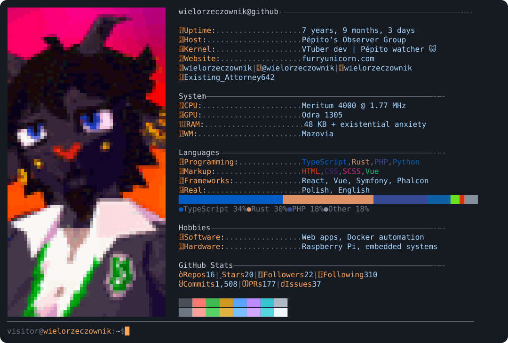

  <picture>
    <source media="(prefers-color-scheme: dark)" srcset="https://raw.githubusercontent.com/wielorzeczownik/wielorzeczownik/output-neofetch/neofetch-dark.svg" />
    <source media="(prefers-color-scheme: light)" srcset="https://raw.githubusercontent.com/wielorzeczownik/wielorzeczownik/output-neofetch/neofetch-light.svg" />
    
  </picture>

